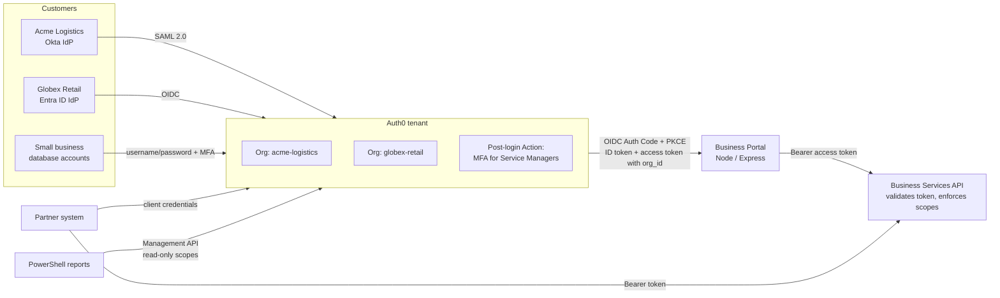

# Auth0 B2B Customer Identity (CIAM) Lab

A hands-on build of **B2B customer identity** on Auth0 (Okta Customer Identity Cloud): one customer portal serving multiple business customers, each isolated as an **Organization**, with customers signing in through **their own IdP** (Okta over SAML, Microsoft Entra ID over OIDC), a **protected API** enforcing RBAC, **machine-to-machine** partner access, **lifecycle/offboarding** controls, and **attack protection + MFA**.

Built in a personal Auth0 tenant, Okta Integrator tenant, and Entra ID tenant. All company names are fictional.

## Architecture



## What's in this repo

| Path | Contents |
|---|---|
| [`portal/`](portal) | Regular web app: OIDC login (Auth Code + PKCE), calls the API on the user's behalf |
| [`api/`](api) | Resource server: validates signature/issuer/audience/expiry (401) and scopes (403) |
| [`actions/`](actions) | Post-login Action: risk-based MFA for privileged roles |
| [`scripts/`](scripts) | PowerShell: client-credentials tokens, API auth tests, read-only Management API tenant report |
| [`docs/`](docs) | Write-ups for each lab plus a troubleshooting log |

## Labs

1. [OIDC login and a protected API with RBAC](docs/01-oidc-login-and-api.md): Authorization Code + PKCE traced in DevTools, back-channel token exchange confirmed in logs, 401 vs 403, RBAC roles.
2. [B2B Organizations and federation](docs/02-b2b-organizations-and-federation.md): SAML from Okta and OIDC from Entra into per-customer Organizations, JIT membership, `org_id` in tokens, tenant isolation tested.
3. [External identity lifecycle](docs/03-external-identity-lifecycle.md): what actually revokes access at the customer IdP, the platform, and the token layer.
4. [M2M and Management API automation](docs/04-m2m-and-management-api.md): partner client credentials, secret rotation, least-privilege admin reporting.
5. [Attack protection and MFA](docs/05-attack-protection-and-mfa.md): brute force, IP throttling, breached passwords, bot detection, FIDO2/OTP, role-based MFA.
6. [Troubleshooting log](docs/troubleshooting-log.md): 12 real failures and how each was diagnosed from errors and logs.

## Key findings

- **Auth0 normalizes federation.** A SAML assertion from Okta and an OIDC code from Entra both end as the same OIDC token for the app.
- **Membership is enforced at login, not continuously.** Removing a user or blocking them stops *new* logins; issued tokens live until `exp`. Short token lifetimes and session revocation close the gap.
- **The service provider has the final say.** A user blocked in Auth0 is denied even when the customer's IdP authenticates them.
- **401 ≠ 403.** Authentication failures (bad/expired/wrong-audience token) vs authorization failures (valid token, missing scope) point to different fixes.
- **Least privilege is verified, not assumed.** Decoding tokens exposed over-permissioned roles; a read-only Management API token gets 403 on delete.

## Running locally

Prerequisites: Node.js 18+, an Auth0 tenant with a Regular Web App, an API (identifier set as the audience), and RBAC enabled.

```powershell
# API (port 4000)
cd api
npm install
$env:API_AUDIENCE = "https://api.example.test"
$env:ISSUER_BASE_URL = "https://YOUR_TENANT.us.auth0.com/"
npm start

# Portal (port 3000), in a second window
cd portal
npm install
Copy-Item .env.example .env   # then fill in your values
npm start
```

Allowed Callback URL: `http://localhost:3000/callback` · Allowed Logout URL: `http://localhost:3000`

## Security notes

- No secrets are committed: `.env` is git-ignored and only `.env.example` with placeholders is included. CI runs **gitleaks** on every push.
- The portal's `/tokens` route exists **for learning only**, to decode tokens at jwt.io. Never expose tokens like this in a real app, and never paste production tokens into third-party sites.
- Screenshots and logs in `docs/` are redacted: no client secrets, tokens, tenant IDs, IP addresses or locations.

## Skills demonstrated

OAuth 2.0 · OIDC · SAML 2.0 · PKCE · JWT validation · Auth0 Organizations · enterprise federation (Okta, Entra ID) · JIT provisioning · RBAC · M2M / client credentials · Auth0 Management API · Auth0 Actions · MFA / FIDO2 · attack protection · PowerShell automation · log-driven troubleshooting
